# LEX-IA

LEX-IA transcrit des enregistrements et des vidéos YouTube sur un ordinateur équipé d’un GPU NVIDIA.

## Premiers pas

1. Lance `tray.bat`. Quand l’icône près de l’horloge devient verte, double-clique dessus pour ouvrir LEX-IA.
2. Choisis **Transcrire un lien** pour une vidéo YouTube, **Transcrire un fichier** pour un enregistrement local ou **Télécharger une vidéo** pour récupérer un MP4.
3. Une fois la transcription prête, choisis **Relire et corriger** pour modifier le texte en écoutant l’audio. Tu peux aussi exporter directement depuis le résultat.

Pour un entretien dont tu connais les participants, coche **Distinguer les personnes qui parlent** et indique le **Nombre exact**. Pour une vidéo où tu connais seulement la limite, utilise **Nombre maximal**. Sinon, garde **Autodétection**.

## Prérequis
- Windows x64 et Python 3.12 avec le lanceur `py.exe`
- GPU NVIDIA avec pilote compatible CUDA 12.8, bibliothèques CUDA 12 et cuDNN 9 accessibles à CTranslate2
- ffmpeg dans le PATH
- Git (pour l'installation de NeMo)

## Installation

Depuis l'explorateur ou une invite de commandes Windows :

```bat
install.bat
```

Le script réutilise ou crée `.venv`, installe les versions de [constraints-windows.txt](constraints-windows.txt)
et vérifie CUDA. Pour repartir de zéro, arrête LEX-IA, renomme `.venv` en `.venv.old`,
puis relance le script. Les modèles sont téléchargés à leur première utilisation.

Pour activer la diarisation, copie `.env.example` en `.env`, accepte les conditions
de [Community-1](https://huggingface.co/pyannote/speaker-diarization-community-1) et
renseigne `HF_TOKEN`. Dans les **Réglages avancés**, **Vérifier la détection des voix** vérifie le chargement du modèle local.
Un jeton précédemment utilisé pour pyannote 3.1 peut être réutilisé s'il a accès à Community-1.

## Lancement

### Icône de zone de notification (recommandé)
```bat
tray.bat
```
Une icône apparaît près de l'horloge et pilote le serveur sans console.

Menu (clic droit) :
- **Ouvrir LEX-IA** ouvre http://localhost:5000, comme le double-clic sur l’icône.
- **Démarrer le serveur**, **Suspendre**, **Reprendre**, **Redémarrer le serveur** et **Arrêter le serveur** pilotent le serveur.
- **Ouvrir le journal** — sortie du serveur dans `logs/server.log`
- **Afficher l’icône au démarrage de Windows** crée le raccourci de démarrage de session.
- **Démarrer le serveur avec l’icône** lance le serveur à l’ouverture de l’icône.

Couleur de l'icône : gris = arrêté, bleu = démarrage, vert = prêt, orange = suspendu, rouge = erreur.

Le serveur devient prêt après le chargement de Whisper. Canary et pyannote se chargent
à leur première utilisation. **Suspendre** gèle le processus mais garde la VRAM allouée ; seul
**Arrêter le serveur** décharge les modèles du GPU.

### Console
```bat
run.bat
```

## Démarrage automatique de Windows

Coche **Afficher l’icône au démarrage de Windows** dans le menu de l’icône. Un raccourci est créé
dans le dossier de démarrage de la session, sans droits administrateur. Décoche
pour le retirer.

## Mise à jour yt-dlp

Au démarrage, LEX-IA vérifie si une nouvelle version de yt-dlp est disponible.
La tentative dure au maximum une minute. Si elle échoue, le serveur continue à démarrer.
La version utilisée est visible sous **Mode d’emploi → Module YouTube**.

Pour lancer une mise à jour manuelle, arrête LEX-IA puis lance le script suivant.
```bat
update.bat
```

Relance le serveur après `update.bat`. Pour conserver les versions verrouillées
par `install.bat`, définis `LEXIA_SKIP_YTDLP_UPDATE=1` dans `.env`.

## Architecture




Whisper large-v3 transcrit les passages horodatés et les langues autres que l’anglais. Canary-Qwen-2.5B peut transcrire l’anglais sans horodatage. pyannote Community-1 distingue les voix, yt-dlp et Deno récupèrent les sources, FFmpeg traite les médias, et Flask et Waitress servent l’application sur le réseau local.

## Corriger et exporter

Dans **Relire et corriger**, **Nommer ou fusionner les voix** affiche le temps de parole
et permet d’écouter un extrait avant de renommer ou de fusionner une voix. Pour
défaire une fusion, efface son choix dans cette fenêtre.

Ouvre **Ajuster la détection des voix** et choisis **Relancer la détection** pour
recalculer les attributions sur les passages existants. Le texte et les repères de
temps sont conservés. **Annuler la dernière correction des voix** rétablit les
anciennes attributions, les noms et les fusions, y compris après une relance.
Si la détection échoue, tu peux toujours relire et exporter le texte.

Filtre les passages par locuteur pour écouter un extrait et change le locuteur
d'un passage directement près de son timestamp. Le menu **Exporter** reprend le
texte corrigé dans l'ensemble du lecteur, même si un filtre est actif.

- **TXT** pour le texte et **JSON** pour les passages horodatés, les locuteurs et les tours bruts du modèle.
- **SRT** ou **VTT** pour les sous-titres. Laisse **Activer les repères de temps et les sous-titres**
  coché pour obtenir des passages horodatés, y compris en anglais. Ce réglage choisit
  Whisper. Décoche-le pour laisser Canary transcrire l'anglais sans timestamps.

Le WAV nécessaire à la relance est conservé temporairement avec le résultat,
environ 110 Mio par heure d'audio. Les exports téléchargés restent sur ton ordinateur.

Pour comparer les réglages sur un entretien ou une vidéo, suis le
[protocole d'évaluation](docs/evaluation-diarisation.md).

Quatre transcriptions peuvent être admises à la fois et sont traitées dans l'ordre d'arrivée.
Deux téléchargements vidéo peuvent tourner en parallèle. Les résultats et leurs médias
expirent après 24 heures. Les corrections restent dans l’onglet. Exporte-les pour les conserver.

Les tests locaux utilisent FFmpeg et ne téléchargent aucun modèle :

```bat
.venv\Scripts\python.exe -m unittest discover -s tests -v
```

Avec Node.js installé, `node tests/test_editor.cjs` vérifie le lecteur, les fusions et le suivi des jobs.
